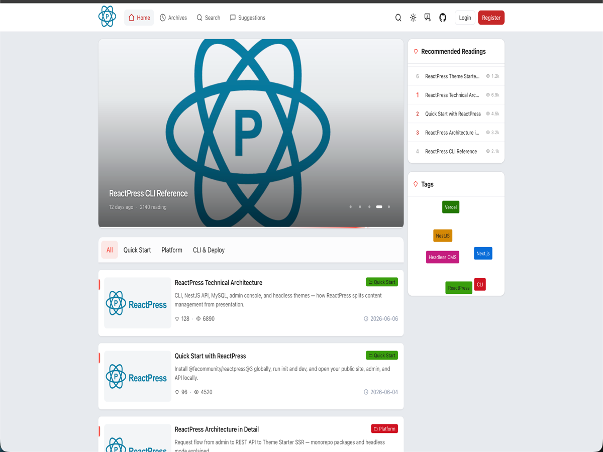

# ReactPress for WordPress

<div align="center">

<a href="https://www.reactpress.cc/">
  
</a>

<br />

**Official WordPress block theme for [ReactPress](https://www.reactpress.cc/)** — package slug `reactpress-blog`

<br />

[Docs](https://reactpress.cc/) ·
[ReactPress](https://github.com/reactpressjs/reactpress) ·
[Theme Starter](https://github.com/reactpressjs/reactpress-theme-starter) ·
[WordPress.org ticket](https://themes.trac.wordpress.org/ticket/298039)

<br />


</div>

---

A clean two-column Full Site Editing (FSE) theme aligned with the [ReactPress Theme Starter](https://github.com/reactpressjs/reactpress-theme-starter) layout: hero carousel, category filter, article cards, and recommended sidebar.

| | |
| --- | --- |
| Theme name | ReactPress for WordPress |
| Package / text domain | `reactpress-blog` |
| Version | 1.3.13 |
| Requires at least | WordPress 6.4 |
| Requires PHP | 7.4 |
| Tested up to | 7.1 |
| License | GPLv2 or later |
| Review ticket | [#298039](https://themes.trac.wordpress.org/ticket/298039) |

## Local install

1. Symlink or copy this repo into `wp-content/themes/reactpress-blog`.
2. Activate **ReactPress for WordPress** under Appearance → Themes.
3. Open Appearance → Editor to adjust navigation, styles, and template parts.
4. Optional: select the **Dark** style variation under Styles.
5. Optional: Appearance → Customize → **ReactPress for WordPress** for colors, infinite scroll, and feed settings.

## Package for WordPress.org

```bash
bash pack.sh
```

Creates `dist/reactpress-blog.zip` with archive root `reactpress-blog/` (WordPress.org requirement). `pack.sh`, `README.md`, and `SUBMIT.md` are excluded from the zip.

Upload at https://wordpress.org/themes/upload/

See [`SUBMIT.md`](./SUBMIT.md) for the review checklist.

## Features

- Block theme with Site Editor support
- Home hero carousel (sticky / recent posts with covers)
- Category filter bar and ReactPress-style article cards
- Sidebar with recommended readings and colorful tags
- Header tools: search, light/dark toggle, optional GitHub link, login/register
- Infinite scroll for the post feed (optional classic pagination)
- Customizer panel for colors, sidebar width, and feed settings
- Single post, page, archive, search, and 404 templates
- Light default palette and Dark style variation

## Related

- [ReactPress](https://github.com/reactpressjs/reactpress) — CMS, admin, CLI
- [ReactPress Theme Starter](https://github.com/reactpressjs/reactpress-theme-starter) — Next.js public site theme
- [ReactPress for VS Code](https://github.com/reactpressjs/reactpress-for-vscode) — publish companion
- [Documentation](https://reactpress.cc/)

## License

GPLv2 or later. See `license.txt` and `readme.txt`.

ReactPress for WordPress Theme, Copyright 2024–2026 ReactPress / FECommunity.
